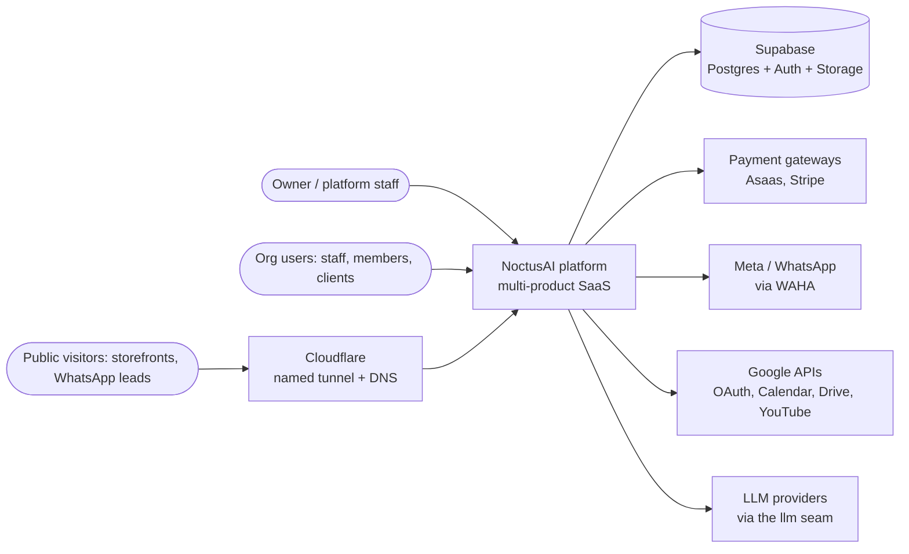
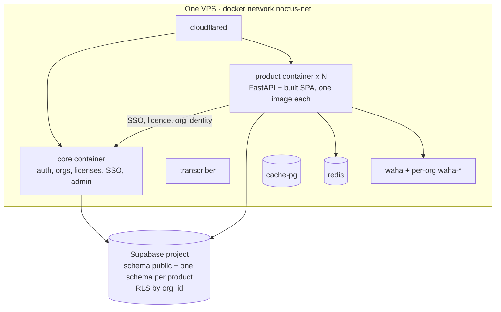
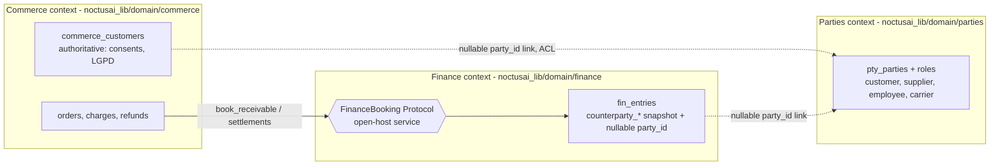

# Architecture craft canon — the architect's textbook, mapped onto this platform

**What it is.** The software-architecture profession's canon — decision records, quality attributes, architecture evaluation, views, fitness functions, strategic domain design, deployment-unit style, evolution patterns, multi-tenancy and the team lens — written as an operating manual for the `architect` agent and anyone who reviews a plan. Every section says what the canon teaches, where this codebase already does it (with file:line), what is missing, a checklist and the anti-patterns.

**Why it exists.** The 2026-11-05 read-only audit of the `architect` and `engineer-seed` agents (agent-refinement project; the audit file lives in that project folder and goes when the project is archived — this doc carries its conclusions) found the architect strong on *where code goes* (bone or organ, seam or fork, N=2/3 recurrence) and weak on *what a design trades off*. It had no record format for an affirmative choice, no quality-attribute reasoning, no view of the platform, and no map of which keeper protects which architectural property. The house already practises much of the canon under other names; this doc names it, so an architect can reason in both vocabularies and spot the gaps.

**How to use it.** The house mechanism wins over the general canon. Where this doc and a house pattern disagree, the house pattern is the rule and this doc is wrong — fix it on contact. Read §1 (the term map) and §14 (the one-page checklist) on every design review; open the other sections when the review touches their topic. Read the worked examples (§15) once — they show the method end to end on decisions this platform actually made.

---

## 1 · House term ↔ standard term

The house vocabulary is methodology, not doctrine (`KB § 01-PHILOSOPHY.md`). The standard term is how the rest of the industry — and every cited source — names the same idea.

| House term | Standard term | Where the house version lives | Note |
|---|---|---|---|
| bone / organ | generic or supporting subdomain / core subdomain | `KB § 03-SEED-ARCHITECTURE.md` § Practical decision test (:51) | the 4-question test is sharper than DDD's classification: it asks *where* the code goes, not only what kind it is |
| named seam | published extension point / plug-in interface | `KB § PATTERNS/architect/vertical-seed.md` §2 (:27-55) | declared before market #1 — the published-interface discipline |
| structural fork | divergent copy / clone-and-own | `KB § 03-SEED-ARCHITECTURE.md` § Named seams vs structural forks | the house's main architectural anti-pattern |
| seed default = canonical answer | sensible default / convention over configuration | `KB § PATTERNS/architect/seed-canonical-defaults.md` | a coincidence default is an undocumented one-way door |
| keeper (`check_*`) | atomic, triggered fitness function | `mcp/noctusai/tools/noctus/dev/compliance.py` (173 `def check_*`) | the house already practises evolutionary architecture without the name (§7) |
| gate ↔ mechanism | fitness function + compliance by construction | `KB § PATTERNS/common/gate-methodology-sync.md` | the canon has the gate; the house adds "ship the mechanism too" |
| accept-with-rationale entry | divergence decision record (an ADR for a *divergence*) | `KB § PATTERNS/common/accept-with-rationale.md` | covers divergences; a positive choice needs §3 |
| isolation ladder (L1 tenant → L4 fork) | pool → bridge → silo tenancy spectrum | `KB § PATTERNS/architect/vertical-seed.md` §4 (:78-87) | same spectrum, ordered by cost (§11) |
| approved cutover | branch by abstraction + parallel change with a human switch | `KB § PATTERNS/architect/approved-cutover.md` | the canon has no "owner approves the switch" step; the house adds it |
| absorption | strangler fig / legacy displacement | `KB § GUIDES/absorb-seed-workspace.md` | the sibling workspace is the legacy system being displaced |
| pilot-products-first | canary release for structural change | `KB § PATTERNS/architect/project-execution.md` §2.12 (:619) | canary over a *code* change, not over traffic |
| Phase-0 audit | architecture recovery / as-is analysis | `KB § PATTERNS/architect/project-execution.md` §2.5 (:358) | "estimate off evidence" is the as-is view before the to-be |
| replication-to-seed symmetry | DRY at the architecture level / single point of change | `KB § PATTERNS/architect/project-execution.md` (:298) | fires on LANGUAGE ("per-product X"), before code exists |
| product catalog (`ativo` + `deploy_scope`) | service catalog / deployment inventory | `KB § PATTERNS/architect/product-working-scope.md` | derived files: `deploy/fleet/active-scope.txt`, `build-scope.txt` |
| specialist agent lens | team type (Team Topologies) | `.claude/agents/*.md` | §12 |
| `[F]/[R]/[A]` triage | decision outcome over a divergence | `KB § PATTERNS/common/doc-symbology.md` §1 | the output shape for divergences, not for choices |

---

## 2 · Reversibility first — spend rigor in proportion

**Principle.** Fowler's *Who Needs an Architect?* (IEEE Software, 2003) frames architecture as the decisions that are hard to change. So the first question about any decision is how hard it is to undo. A **two-way door** (cheap to reverse) is decided quickly and inline. A **one-way door** (expensive or impossible to reverse) deserves a record, a measurable quality scenario and a guard. Decide one-way doors at the **last responsible moment** — late enough to have the facts, early enough that not deciding does not decide for you.

**How it applies here.** The house has one-way doors that look like ordinary edits:

| One-way door in this codebase | Why it is hard to undo | Evidence |
|---|---|---|
| a seed default or seed export | every awake product inherits it at install; consumers depend on observed behaviour (Hyrum's law, §10) | `check_seed_canonical_default` (compliance.py:10680), `check_seed_export_membership` (:5408) |
| an applied migration | `migrate_product` never re-runs a file; an applied organ migration is frozen | `KB § PATTERNS/architect/vertical-seed.md` :111 |
| a tenancy placement (pool vs dedicated) | moving a client between levels is an org export → deploy → DNS → webhooks job | `vertical-seed.md` :84 |
| a public contract (HTTP route shape, JSON-Schema contract, webhook) | external callers and other products bind to it | e.g. `contracts/channels.v2.json` in `agents` (`KB § 02-LANDSCAPE.md` Agentes row) |
| a named seam's signature | every pack and every market product fills it | `vertical-seed.md` :71-72 |
| prod exposure of a product | the owner's decision, recorded with consent | `KB § PATTERNS/devops/prod-exposure-consent.md` |

Two-way doors in this codebase: an internal function name inside one product, a page layout, a private helper, a test fixture, a feature behind an org setting that defaults off.

**Rigor tiers.**

| Tier | Test | Required artefacts |
|---|---|---|
| T0 two-way, local | one product, internal, no schema / contract / default touched | none beyond the commit message |
| T1 two-way, shared | touches the seed or lib but is additive and back-compatible | consumer check (§10) + pilot-first (`project-execution.md` §2.12) |
| T2 one-way | schema, tenancy, public contract, seed default, new seam, deployment-unit change | decision record (§3) + quality scenario (§4) + fitness function (§7) |
| T3 one-way, owner-level | prod exposure, money movement, LGPD category, provider cutover | T2 + the owner's recorded decision (`approved-cutover.md` §2, `prod-exposure-consent.md`) |

**Checklist.**
- Classify the decision T0-T3 before recommending anything; say the tier in the recommendation.
- A T2/T3 decision is never a single line in `PROJECT.md` — projects are deleted on archive.
- "We can always change it later" must name *how*: the migration, the cutover, the consumer list.

**Anti-patterns.** Same ceremony for every decision (slows the two-way majority to the pace of the one-way minority). A one-way door taken implicitly — a coincidence default, a column name, a route shape — with no record that it was a choice.

---

## 3 · Decision records — Nygard, MADR, and accept-with-rationale

**Principle.** Nygard (2011) proposed the Architecture Decision Record: a short text file per decision with **Title, Context, Decision, Status, Consequences**. Decisions are never deleted — a reversed one is marked *superseded* with a link to its replacement, and numbers are never reused. MADR 4.0.0 (2024-09-17) extends it with **Decision Drivers, Considered Options, Decision Outcome, Consequences, Confirmation** and **Pros and Cons of the Options**. arc42 §9 is where decisions sit in a full architecture document.

**How it applies here.** The house has a record for *divergences* — `KB § PATTERNS/common/accept-with-rationale.md` (opening, :3-19: "Projects close and their folders get deleted … Without a durable home, the **why** … leaks out of the codebase"). It has no record for *affirmative choices*. A grep of the KB for ADR / MADR / "decision record" returned nothing (audit, 2026-11-05). Load-bearing choices — one shared Supabase, schema per product, RLS by `org_id` — exist only as facts scattered across docs (`KB § 02-LANDSCAPE.md` :69, `KB § PATTERNS/backend/database-rls.md` :19-25, `KB § PATTERNS/devops/dev-fleet-dormant.md` :33).

**Divergence vs choice.**

| | accept-with-rationale | decision record (ADR) |
|---|---|---|
| Records | a legitimate departure from a platform ideal | a positive choice among options |
| Trigger | triage outcome `[A]` | any T2/T3 decision (§2) |
| Shape | reason · scope · revisit trigger | context · drivers · options · outcome · consequences · confirmation |
| Lives in | `KB § PATTERNS/common/accept-with-rationale.md` register | the decision-record folder (below) |

**The house template (MADR fields + the house's revisit trigger and fitness function).**

```markdown
# ADR-NNNN <short title as a noun phrase>
Status: proposed | accepted | superseded by ADR-MMMM | deprecated     Date: YYYY-MM-DD
Deciders: <owner / tech-lead / architect>      Tier: T2 | T3 (§2)

## Context and problem statement      <- facts, neutral; the forces and their tension
## Decision drivers                   <- the quality attributes at stake (§4), named
## Considered options                 <- at least two, including "do nothing" when real
## Decision outcome                   <- chosen option + one-paragraph why
### Consequences                      <- good, bad, neutral; the trade-off points (§5)
### Confirmation                      <- the fitness function(s) that go red if this erodes (§7)
## Revisit trigger                    <- the observable condition that reopens it (house addition)
## Pros and cons of the options       <- optional, one sub-heading per option
```

**Where records live.** Proposed home: `project-history/decisions/ADR-NNNN-<slug>.md` — append-only, numbered, never deleted, outside project folders so archiving cannot destroy them, and next to the other durable ledgers in `project-history/`. The folder does not exist yet. The first T2 decision the tech-lead ratifies creates it; until then a record is carried in the recommendation itself and in this doc's §15 worked examples. Placing the folder is itself a T1 decision for the tech-lead (named destination; Wave 3 of the agent-refinement project).

**Checklist.**
- Every T2/T3 recommendation carries an ADR-shaped block, even when the folder does not exist yet.
- Context is facts with file:line, not opinion. Considered options include the cheapest viable one.
- Confirmation names a real keeper (§7 map) or a `NOC-REMEDIATE[<class>]` destination (`KB § PATTERNS/common/remediation-markers.md`).
- Superseding: write a new record and mark the old one superseded; never edit an accepted record's decision.

**Anti-patterns.** Decision buried in a `PROJECT.md` that is deleted on archive. An ADR with one option (a justification, not a decision). An ADR with no consequences, or only good ones. Using accept-with-rationale for a positive choice.

---

## 4 · Quality attributes — name them, measure them, trade them

**Principle.** A design is good only *for* something. The SEI tradition (Bass, Clements, Kazman, *Software Architecture in Practice*) makes quality attributes concrete with **quality-attribute scenarios** of six parts: **source, stimulus, artifact, environment, response, response measure** (arc42 §10.2's long form adds an id and a name). Scenarios are ranked in a **utility tree** — quality at the root, attributes, refinements, scenarios at the leaves — each tagged (importance, difficulty). arc42 §10.2 separates **usage scenarios** (runtime reaction) from **change scenarios** (cost of a modification). AWS and Azure Well-Architected give pillar checklists (reliability, security, cost, performance, operational excellence, sustainability) as a coverage check.

**How it applies here.** The house has budgets and guards for several attributes but never states the trade-off between them. Latency lives in skill `noc-fast-responses` and `deploy/fleet/latency-budgets.json` (shell/me 150 ms, reads 300 ms, writes 500 ms p95 — `KB § PATTERNS/backend/request-path-latency.md` :64); security in the `security` agent; tenancy in backend docs; prod safety in `predeploy_check`. The architect's job is to force the trade-off into the open.

**Starter utility tree for this platform** (importance H/M/L, difficulty H/M/L).

| Attribute | Refinement | Scenario (source · stimulus · artifact · environment · response · measure) | Imp/Diff |
|---|---|---|---|
| Tenant isolation | cross-org read | An authenticated member of org A · requests org B's rows through PostgREST with the product schema · product tables · prod · RLS returns nothing · 0 rows, every time, for every org-owned table | H/M |
| Tenant isolation | staff acting as an org | Platform staff · selects a target org in a ready product · `current_org_id_for(<schema>)` · prod, aal2 · policies scope to the selection only while it is live and licensed · 0 reads outside the live selection | H/H |
| Latency | read path | A user · opens a list page · product backend read route · prod, normal load · responds within budget · p95 ≤ 300 ms (`latency_report` verdict `ok`) | H/M |
| Deploy safety | bad image | A deploy · ships an image whose container fails health · `deploy_image` · prod (dev fleet dormant) · auto-rollback to the previous image · prod serving the previous image, no manual step | H/M |
| Cost per tenant | noisy neighbour | One org · runs a heavy job or an LLM loop · shared container + shared Supabase · prod · bounded per org · per-org limits hold; other orgs' p95 unchanged | M/H |
| Evolvability | seed change | A seed engineer · changes a seed export · all awake products · dev · pilots go green first, then fan-out · change lands in 1 seed edit, 0 per-product edits | H/M |
| Privacy (LGPD) | erasure / portability | A data subject · requests export or erasure · org-scoped tables + storage · prod · per-org export / delete · completes for every table and bucket the org owns | H/H |
| Operability | diagnose a failure | The owner · sees a failing product in the morning brief · container logs + watchdog · prod · cause found from logs without SSH archaeology · minutes, not hours | M/M |

**Sensitivity and trade-off points** (ATAM terms, §5). A *sensitivity point* is a property of one component that a quality attribute depends on (RLS policy shape ⇒ isolation; PostgREST round-trip count ⇒ latency). A *trade-off point* is a property that affects two attributes in opposite directions. Recurring trade-off points here:

- **One shared Supabase project**: cost and SSO simplicity vs blast radius and noisy neighbour (§15.1).
- **One container per product on one VPS** (`deploy/fleet/README.md` :3-4): operational simplicity and cost vs single host as a shared failure domain.
- **Org settings over packs over dedicated instances** (`vertical-seed.md` :87): cost vs per-client freedom.
- **Thread-pool sync DB calls** (`check_async_handler_sync_db`, compliance.py:9319): simplicity of the sync client vs event-loop latency.

**Checklist.**
- Every recommendation states which attributes it optimizes and which it spends — in words, then as at least one scenario with a measure.
- A scenario without a response measure is a wish. "Fast" is not a measure; "p95 ≤ 300 ms on the `latency_report`" is.
- Check the Well-Architected pillars for coverage — a design silent on cost or operability has not considered them.

**Anti-patterns.** "-ilities" listed without measures. Optimizing one attribute silently (a cache that breaks isolation; an isolation fix that adds four round trips). Treating the latency budget as the only quality attribute because it is the only one with a JSON file.

---

## 5 · Lightweight architecture evaluation — a 30-minute plan review

**Principle.** The Architecture Tradeoff Analysis Method (Kazman, Klein, Clements — SEI technical report CMU/SEI-2000-TR-004) evaluates an architecture against prioritized scenarios and produces **risks, non-risks, sensitivity points and trade-off points**. Full ATAM takes days with stakeholders. The useful core — scenarios first, approaches mapped to scenarios, risks named — fits in half an hour for a plan.

**How it applies here.** The house reviews plans for seed-first compliance (`KB § GUIDES/seed-first-design.md`; the 4-question test) and recurrence. It has no broader rubric. Use this one at Phase 0 and before any T2/T3 recommendation.

**The 30-minute ATAM-lite.**

| Step | Minutes | Output |
|---|---|---|
| 1. Restate the business goal and the tier (§2) | 3 | one sentence + T0-T3 |
| 2. Pick the 3-5 scenarios from the utility tree (§4) this plan touches; add any new one | 5 | scenario list with measures |
| 3. List the architectural approaches the plan uses (seam, organ, cache, queue, schema change, new container) | 5 | approach list |
| 4. For each scenario, walk the approach: what makes it hold, what breaks it | 10 | sensitivity points, trade-off points |
| 5. Classify: **risk** (an approach that may not meet a scenario), **non-risk** (one that clearly does), **trade-off** | 4 | three lists |
| 6. For each risk: mitigation, fitness function (§7), or accept with a revisit trigger | 3 | actions |

Run the seed-first lens inside step 3: the 4-question test (`KB § 03-SEED-ARCHITECTURE.md` :51), verify-the-seed-ships-it (:62), the recurrence scan (`project-execution.md` §2.7, :437).

**Risk storming variant.** When several specialists are involved, ask each lens (security, backend, devops, frontend) to mark the riskiest part of the container view (§6) independently, then compare. Disagreement is the finding.

**Anti-patterns.** Reviewing only for seed-first compliance. A review that lists no non-risks (it did not look). Risks with no owner and no destination.

---

## 6 · Views — C4 for this platform

**Principle.** The C4 model (Simon Brown) draws software at four zoom levels: **System Context** (the system, its users, the systems it talks to), **Container** (separately deployable or runnable units and data stores), **Component** (the parts inside one container), **Code** (optional). Supplementary diagrams cover deployment and dynamic flows. arc42 §3 (context), §5 (building blocks) and §7 (deployment) are the document homes for the same views.

**How it applies here.** No context or container view of the platform existed (audit: grep for mermaid / "system context" in 02/03/05 returned nothing), so every architect re-derived the topology. The views below are derived from the files cited. The **roster** is not repeated here — it is derived elsewhere: products from `KB § 02-LANDSCAPE.md` (keeper-enforced roster parity), awake products from `deploy/fleet/active-scope.txt` (generated), prod services from `deploy/fleet/docker-compose.prod.yml`. Regenerate the container view from those, never hand-maintain a product list here.

**Level 1 — System context.**



**Level 2 — Container (prod).**



Sources for the container view: one VPS, slim `runtime` images from GHCR, Cloudflare named tunnel, all layers on `noctus-net` with no host ports (`deploy/fleet/README.md` :1-16); product services (`deploy/fleet/docker-compose.prod.yml` :120-646, e.g. `core` :120, `agents` :398, `nosnolimiar` :646); `transcriber` (:676, sanctioned in `deploy/fleet/services.txt`); infra `redis` / `cache-pg` / `waha` (`deploy/fleet/compose.infra.prod.yml` :46, :66, :105); per-org WAHA (`deploy/fleet/compose.waha.yml` :8); `cloudflared` (`deploy/tunnel/compose.tunnel.yml` :26); 19 schemas declared (`KB § 02-LANDSCAPE.md` :69). The house container model — one container per product, `serve_spa`, seed base image — is `KB § PATTERNS/devops/containerization.md` §12a.

**Level 3 — Component, per organ.** Draw it for one organ when a decision touches it. Example: the finance organ is `noctusai_lib/domain/finance/*` (routers, services, SQL generator, `guards.py`), mounted by `noctusai_seed.organs.mount_finance` (`seed/framework/backend/noctusai_seed/organs.py` :233), its migration rendered by `noctus.dev.render_organ_migration`, its FE `FinanceRoutedPage` from `@noctusai/lib` (`vertical-seed.md` :97-113). Other organs talk to it only through the `FinanceBooking` Protocol (`seed/lib/backend/noctusai_lib/domain/finance/booking.py` :55) — §8.

**Development-time view.** The dev toolkit is a separate system: the `noctusai` MCP server (`mcp/noctusai/`), keepers in `compliance.py`, git hooks in `scripts/hooks/`, the agent fleet in `.claude/agents/`. It never runs in prod. Draw it when a decision is about the methodology, not the product.

**Checklist.**
- A T2 decision names the C4 level it changes and redraws that view in the record.
- Diagrams are text (mermaid) in KB so they diff and review like code.
- A view that hand-lists products is wrong by construction — point at the derived roster.

**Anti-patterns.** Boxes and arrows with no legend or level. One diagram mixing context, containers and code. A topology diagram that silently drifts from the compose files.

---

## 7 · Fitness functions — every decision ships its guard

**Principle.** *Building Evolutionary Architectures* (Ford, Parsons, Kua, Sadalage) defines an **architectural fitness function** as an objective integrity assessment of an architectural characteristic. Taxonomy: **atomic** (one characteristic, one context) vs **holistic** (several together); **triggered** (on an event such as a commit) vs **continual** (always running, e.g. monitoring); static vs dynamic. The rule that follows: a decision about a characteristic is not done until something objective goes red when the characteristic erodes.

**How it applies here.** The house's keepers are atomic, triggered fitness functions, run at pre-commit / pre-push / CI (`KB § PATTERNS/common/gate-methodology-sync.md`). Runtime probes (`noctus.dev.verify_db_guards`, `noctus.dev.latency_report`, `noctus.dev.prod_watchdog`) are the dynamic and continual ones. The house adds a rule the canon lacks: the gate ships **with** its compliance-by-construction mechanism, so it is a backstop rather than a wall. What was missing is the map. Without it, "is quality X guarded?" had no answer.

**Characteristic → fitness function map** (real names; line = `def` in `mcp/noctusai/tools/noctus/dev/compliance.py` unless noted).

| Characteristic | Fitness functions (keeper / probe) | Kind |
|---|---|---|
| Tenant isolation — RLS present | `check_new_org_table_rls` (:16112, blocking delta), `check_table_has_rls` (:15975, advisory) | atomic, triggered, static |
| Tenant isolation — policy correctness | `check_rls_policy_self_reference` (:2918), `check_status_pagina_role_parity` (:13900), `check_org_identity_function_parity` (:14165), `check_org_picker_ready_policies` (:14383) | atomic, triggered, static |
| Tenant isolation — grants and bypass | `check_schema_wide_anon_grant` (:14961), `check_no_authenticated_grant_on_content_tables` (:13309), `check_admin_endpoint_service_role_bypass` (:3069), `check_storage_bucket_public` (:15259) | atomic, triggered, static |
| AuthZ from trusted source | `check_no_metadata_authz` (:12247), `check_org_role_without_org_id` (:12374), `check_admin_gate_hand_rolled` (:24809), `check_hand_copied_org_admin` (:25078), `check_license_gate_by_construction` (:24975) | atomic, triggered, static |
| AuthN test truthfulness | `check_auth_boundary_false_green` (:22974), `check_no_self_monkeypatch` (:1807) | atomic, triggered, static |
| DB guards really refuse | `noctus.dev.verify_db_guards` (`tools/noctus/dev/verify_db_guards.py`), `check_migration_guard_has_probe` (:15761), `check_secdef_migration_revokes_execute` (:13105), `check_function_search_path_pinned` (:2780) | static + dynamic (PGlite probe) |
| Migration integrity | `check_migration_number_collision` (:14776), `check_migration_applied_ledger_drift` (:16277), `check_unknown_table_references` (:2653) | atomic, triggered |
| Seed purity / no forks | `check_canonical_organ_consumption` (:18135), `check_seed_canonical_default` (:10680), `check_out_of_contract_trees` (:765), `check_handrolled_core_url` (:578), `check_consent_routes_mounted` (:18264) | atomic, triggered |
| Seed inheritance works | `check_seed_export_membership` (:5408), `check_seed_version_propagation` (:809), `check_seed_declared_imports` (:7078), `check_product_declared_imports` (:7263), `check_standard_routers_audit` (:374) | atomic, triggered |
| Integration through seams | `check_redis_client_via_seam` (:7447), `check_no_direct_llm_sdk_import` (:12151), `check_settings_di_regression` (:3256) | atomic, triggered |
| Latency | `check_async_handler_sync_db` (:9319), `check_postgrest_unbounded_query` (:13533); runtime `noctus.dev.latency_report` vs `deploy/fleet/latency-budgets.json` | static + continual (post-deploy) |
| UI truthfulness (server state) | `check_lying_loading_state` (:11502), `check_mutation_invalidate_only` (:8782) | atomic, triggered |
| Container / deploy shape | `check_product_container_shape` (:10297), `check_prod_compose_hardening_parity` (:24585), `check_prod_compose_env_manifest_sync` (:25454), `check_tunnel_ingress_snapshot_sync` (:24477) | atomic, triggered |
| Prod safety | `check_pre_deploy_gate` (:22443), `check_predeploy_leg_verify_or_block` (:18892), `check_prod_exposure_consent` (:24729); runtime `noctus.dev.predeploy_check`, `deploy_image` auto-rollback | holistic + dynamic |
| No hand-maintained lists | `check_hardcoded_product_slug_set` (:5688), `check_every_test_file_is_gated` (:7868) | atomic, triggered |
| No silent errors | `check_silent_errors` (:2002) | atomic, triggered |
| Privacy (LGPD) | `check_lgpd_entry_removal` (:12798), `check_ledger_pii` (:17804) | atomic, triggered |
| The fitness functions themselves | `check_detector_has_regression_test` (:17919), `check_guard_hooks_registered` (:23767), `check_agent_kb_alignment` (:19647) | meta |

**Gaps the map exposes** (open; named destinations, not silent):
- **Noisy neighbour / per-tenant cost (compute and DB)** — LLM spend IS covered: the llm seam records each call "attributed and priced" into `public.ai_usage` and "enforces the per-org budget guard", and `check_no_direct_llm_sdk_import` keeps every call on that seam (compliance.py:12151-12160). Compute and database load per org have no bound and no guard. Destination: architect, with `devops-engineer` (container limits) — candidate scenario in §4.
- **Tenant export / erasure completeness** — no fitness function that every org-owned table and bucket is covered. Destination: `security` (LGPD) with backend, flagged in the canon §11.
- **Shared-DB expand/contract** — no keeper that a column rename or drop has a preceding expand migration. Destination: §10 rule; candidate keeper only at N≥3 recurrence.
- **Fleet RLS behaviour (dynamic)** — the RLS keepers are static. A cross-org read probe per product (the first scenario in §4) is the dynamic counterpart. Destination: candidate for `verify_db_guards`' registry.

**Checklist.**
- A T2/T3 recommendation names the fitness function in its Confirmation field, or names the destination that will build one.
- Before proposing a new keeper, check the map and `noctus.dev.keeper_pattern_lookup` — the guard may exist under another name.
- A new keeper ships its mechanism, its regression test and its hook wiring in the same change (`gate-methodology-sync.md`; `check_detector_has_regression_test`; `check_guard_hooks_registered`).

**Anti-patterns.** A fitness function nobody wired (the keeper exists; no hook runs it). A guard that cannot fail (`KB § PATTERNS/common/methodology-execution-discipline.md` §4, §8). A wall — a gate the normal flow keeps hitting because its mechanism is missing (`gate-methodology-sync.md` § Walls).

---

## 8 · Strategic design — subdomains, bounded contexts, context map, glossary

**Principle.** Evans' *Domain-Driven Design* (2003) and the *DDD Reference* split strategy into: **subdomains** (core = the differentiator; supporting = needed but not differentiating; generic = solved elsewhere); **bounded contexts** (a boundary inside which a model and its language are consistent — Fowler, *BoundedContext*); a **ubiquitous language** per context; and a **context map** naming each relationship. The relationships: *partnership*, *shared kernel*, *customer-supplier*, *conformist*, *anticorruption layer (ACL)*, *open-host service / published language*, *separate ways*.

**How it applies here.**

| DDD | House | Evidence |
|---|---|---|
| generic subdomain | L0 seed bones (auth, SSO, app factory, license gate) | `vertical-seed.md` :13 |
| supporting subdomain shared by a family | L1 vertical organs (`noctusai_lib/domain/<organ>`) | `vertical-seed.md` :14; `seed/lib/backend/noctusai_lib/domain/` (finance, parties, items, inventory, purchasing, quotes, contracts, commerce, …) |
| core subdomain | L2 market product (what that market pays for) | `vertical-seed.md` :15 |
| client-specific variation | L3 org settings, then a pack | `vertical-seed.md` :16, :59-76 |
| open-host service / published language | an organ's Protocol seam (`FinanceBooking`) and the JSON-Schema contracts | `finance/booking.py` :55; `agents` `contracts/channels.v2.json` |
| anticorruption layer | a provider adapter that owns the provider's vocabulary | p-studio `ProvedorCobranca` (§15.2) |
| separate ways | a product that deliberately does not share a model (e.g. `adconnect`'s custom JWT auth) | `KB § 02-LANDSCAPE.md` AdConnect row |

**Context map rules.**
- A new cross-context link declares its relationship in the record: shared kernel, customer-supplier, ACL, open-host or separate ways.
- **Link, never merge** is an ACL / customer-supplier decision. Example: ERP parties vs commerce customers (§15.3).
- Cross-organ calls go through a declared Protocol seam (`FinanceBooking`), never through another organ's tables. The finance bridge says so in its own header (`seed/lib/backend/noctusai_lib/domain/commerce/finance_bridge.py` :1).

**Ubiquitous language.** Domain terms are pt-BR and cross products: `negocios` (deals), `captacoes` (shoot bookings), `producoes` (production jobs) in p-studio (`KB § 02-LANDSCAPE.md` :22); `imóveis`, `clientes`, `contratos` in the real-estate products; `status_pagina` with `producao` / `desenvolvimento` everywhere. The same word can mean different things in two contexts — a `cliente` in p-studio is a payer; in `commerce` the customer is `commerce_customers`; in the ERP organ a customer is a party with role `customer` (`vertical-seed.md` :50). A context's glossary belongs in that product's guide (`KNOWLEDGE-BASE/CONTEXT/PRODUCTS/<slug>/`); a vertical's shared terms belong in the vertical spec (`vertical-seed.md` §5). Code identifiers keep the language of their context — never translate a pt-BR domain term into English in one module and keep it pt-BR in the next.

**Checklist.**
- Classify the subdomain before the layer: core work does not belong in L0; generic work does not belong in L2.
- Name the context-map relationship of every new cross-product or cross-organ dependency.
- Same word, two meanings ⇒ two contexts; record it in both glossaries.

**Anti-patterns.** One model for everything ("the customer table every product reads"). Integrating through a shared table instead of a seam. Building a generic subdomain as if it were core (re-implementing auth per product — the house's `check_canonical_organ_consumption` exists because of this).

---

## 9 · Deployment-unit style — modular monolith, services, and what we actually run

**Principle.** Fowler's *MonolithFirst* and *MicroservicePremium* argue that microservices carry a cost premium that only pays off past a complexity threshold; *MicroservicePrerequisites* lists what must exist first (rapid provisioning, basic monitoring, rapid deployment). Lewis and Fowler's *Microservices* (2014) defines the style: independently deployable services, decentralized data, smart endpoints. Grzybek's *Modular Monolith: A Primer* describes the middle path: one deployable unit with strongly bounded modules that could be extracted later. *Software Architecture: The Hard Parts* (Ford, Richards, Sadalage, Dehghani) gives the disintegration and integration drivers.

**What we actually run.** A hybrid that matches neither label:
- **Code:** a modular monolith of shared packages — `noctusai_seed` (framework), `noctusai_lib` (organs, integrations), `@noctusai/seed` / `@noctusai/lib` — consumed by every product (`vertical-seed.md` :13-14).
- **Deploy:** one container per product (`KB § PATTERNS/devops/containerization.md`), independently deployable via `deploy_image`.
- **Data:** one shared Postgres (Supabase), one schema per product, RLS by `org_id` (§15.1).

So products are *independently deployed* but *not independently versioned in code* (they share the seed at install time) and *not data-independent* (they share one database). In canon terms: a distributed deployment of a modular monolith with a shared database. That is a legitimate position, but it carries two named risks.

**Shared-database integration risks.**
1. **Cross-schema coupling.** Products read core's `public` schema (org identity, licences: `get_core_client`, `KB § 03-SEED-ARCHITECTURE.md` :208) and core reads product rows for admin. Rule: a product reads another schema only through a declared function or view of that schema's owner (e.g. `public.current_org_id_for`, `KB § PATTERNS/backend/tenancy-license-gate.md` :116), never by querying another product's tables directly. Reaching into a peer schema's tables is integration through a shared table — the anti-pattern in §8.
2. **Rolling schema change.** A migration applies to the shared DB while containers running the old image still read it. Every shared-schema change must be compatible with both the old and the new image (§10 expand → migrate → contract).

**When a product earns its own database (silo).** Only when one of these holds: a regulatory or contractual demand for physical separation; a noisy-neighbour profile the pool cannot bound (§11); a release cadence or extension set the shared project cannot host; a client paying for L3 dedicated isolation (`vertical-seed.md` :84). Cost of the move: Supabase Pro ≈ US$25/month if separate, every deploy and migration ×N (`vertical-seed.md` :84).

**When a module earns its own container.** Different runtime dependencies, heavy compute, or an independent release cadence — the same triggers as a pack outgrowing the shared process (`vertical-seed.md` :76). `transcriber` is the in-tree example of a sanctioned non-product service (`deploy/fleet/services.txt`).

**Anti-patterns.** Résumé-driven services — splitting for the sake of the label. The **distributed monolith**: services that must deploy together because they share tables or unversioned contracts. Shared-DB "integration": a second product reading the first product's tables directly.

---

## 10 · Evolution patterns — change without breaking consumers

**Principle.**
- **Parallel change / expand-contract** (Fowler, *ParallelChange*): introduce the new shape alongside the old (expand), migrate every consumer, then remove the old (contract).
- **Branch by abstraction** (Fowler, *BranchByAbstraction*): put an abstraction in front of the thing being replaced, build the replacement behind it, switch, delete the old.
- **Strangler fig** (Fowler, *StranglerFigApplication*; *Patterns of Legacy Displacement*): grow the new system around the old until the old one can be removed.
- **Hyrum's law** (hyrumslaw.com): with enough users of an API, every observable behaviour is depended on by somebody — whatever the contract promises.

**How it applies here.**

| Pattern | House instance | Evidence |
|---|---|---|
| Expand / contract | organ migrations: re-runnable full-state generators, applied files frozen, revisions in `NNN_<organ>_rev<N>.sql` | `vertical-seed.md` :111 |
| Branch by abstraction + human switch | approved cutover (`current` + `next` behind one Protocol, owner approves, validation window, retire) | `approved-cutover.md` :3, :11-18 |
| Branch by abstraction, partial | p-studio `ProvedorCobranca` (§15.2) | `products/p-studio/backend/app/providers/tipos.py` :121 |
| Strangler fig | absorptions — sibling workspace folded in seed-first, capability by capability | `KB § GUIDES/absorb-seed-workspace.md`; orbity row in `KB § 02-LANDSCAPE.md` |
| Canary | pilot-products-first | `project-execution.md` §2.12 :619 |

**Rule — shared-DB schema changes are expand → migrate → contract.** For any column, table, function or policy that more than one container (or the seed) reads:
1. **Expand** — add the new column / function / view; old readers keep working. Deploy.
2. **Migrate** — move writers, backfill, move readers; every image in prod understands both shapes.
3. **Contract** — drop the old shape in a later migration, after every reader is on the new image.

Never rename or drop in one deploy while other containers read the old name. Organ frozen-migrations cover organ tables only; this rule covers everything else.

**Rule — Hyrum's law for seed exports.** Before changing an exported seed symbol or a seed default, list its consumers (`noctus.graph.neighbors`, `noctus.dev.refs`), keep it back-compatible or apply expand/contract, and prove on pilots first (`project-execution.md` §2.12). Additive exports are the cheap path — the pilot rule's evidence is that additive-only seed exports caused zero non-pilot breakage (:625).

**Checklist.**
- Is the change additive? If not, which expand/contract step is this migration?
- Who reads this shape today? List them, do not guess.
- Is there a retirement step with a `NOC-REMEDIATE[...]` marker (`approved-cutover.md` §1 "Retirement gate")?

**Anti-patterns.** Big-bang rename across the fleet. A permanent half-migration (old and new both live forever). Branch by abstraction that never removes the old branch.

---

## 11 · Multi-tenancy — pool, bridge, silo on the isolation ladder

**Principle.** AWS's SaaS Lens defines **silo** (dedicated resources per tenant — a separate stack or a separate database — still with shared identity, onboarding and operations), **pool** (tenants share resources — the classic multi-tenancy for economies of scale) and **bridge** (a mix: some parts siloed, some pooled, per service, chosen by regulatory profile, noisy-neighbour risk and cost). Azure's *Tenancy models* and *Storage and data approaches* add the data-layer options: shared database with a tenant column, database per tenant, schema per tenant, and sharding. PostgreSQL Row Security Policies and Supabase's RLS guide are the mechanism for the pooled data option.

**Mapped onto the ladder** (`vertical-seed.md` §4, :78-87).

| House level | AWS model | Data | Compute | Blast radius (`vertical-seed.md` :80-85) |
|---|---|---|---|---|
| L1 Branded tenant (default) | pool | shared schema, `org_id` + RLS | shared container | every client of the market |
| L2 Extended tenant | pool + pack | shared schema, pack tables `client_<slug>_*` with `org_id` + RLS (:74) | shared container, pack loaded for that org only (:71) | as L1 + their pack |
| L3 Dedicated instance | bridge (own container, maybe own schema) or silo (own Supabase project) | own schema or own project | own container, same image | that client only |
| L4 Personalized fork | outside SaaS (a managed-service model, per AWS) | own | own | them; maintenance compounds |

The platform-level data model is itself a bridge: **schema per product** (19 schemas, `KB § 02-LANDSCAPE.md` :69) with **pool within each product schema** (rows keyed by `org_id`, RLS on every table: `KB § PATTERNS/backend/database-rls.md` :19-20).

**RLS as the pool boundary — and how it fails.**
- RLS is the only isolation in the pool, so every org-owned table needs it (`check_new_org_table_rls`).
- **A policy that filters a category kills every FE branch on it.** `status_pagina` shipped with one policy returning only `producao`, so `desenvolvimento` pages were invisible to everyone including the operator (`KB § PATTERNS/frontend/status-pagina-dev-visibility.md` :1-21). Guard: `check_status_pagina_role_parity`.
- **The service role bypasses RLS** (`database-rls.md` :25). Every admin-client read is outside the pool boundary; guard `check_admin_endpoint_service_role_bypass`.
- **User-writable metadata is not an org claim** (`check_no_metadata_authz`).
- **An exposed schema plus an org-only policy is no defence when the caller may be a member of any org** — the agents studio finding C2 (`database-rls.md` :673).

**What the pool still owes** (gaps from the audit; destinations named):

| Concern | State | Destination |
|---|---|---|
| Noisy neighbour / denial of wallet per org | LLM: per-org budget guard in the llm seam (compliance.py:12154-12157); per-chat abuse limits in `agents` (`KB § 02-LANDSCAPE.md` Agentes row). Compute and DB: no per-org bound | §7 gap list |
| Per-tenant metering and cost attribution | LLM calls attributed and priced into `public.ai_usage` through the llm seam; compute and DB not attributed | architect with `devops-engineer` |
| Tenant-aware observability | not established as a rule | devops (`devops-engineer` canon, W1-S5) |
| Tenant export / erasure (LGPD) | precondition stated: "per-org export/import (LGPD portability too)" (`vertical-seed.md` :87); no completeness guard | security (LGPD) |
| Tenant-isolation test as a fitness function | static keepers only | §7 gap list |

**Checklist.**
- Place every client at the **lowest** level that satisfies them (`vertical-seed.md` :87); state the noisy-neighbour and erasure story at that level.
- A new org-owned table: `org_id`, RLS, policies through `current_org_id_for('<schema>')` (`tenancy-license-gate.md` :116-127).
- Never let an org id select code anywhere except the pack registry (`vertical-seed.md` :71).

**Anti-patterns.** `if org == …` in shared code. Silo by default ("each client gets their own Supabase" — the cost line at `vertical-seed.md` :84 ×N). A pool with no per-tenant limits.

---

## 12 · Team topology lens — the agent fleet as a team design

**Principle.** Conway's law (Fowler, *ConwaysLaw*): a system's design copies the communication structure of the organization that builds it. *Team Topologies* (Skelton, Pais) names four team types — **stream-aligned**, **enabling**, **complicated-subsystem**, **platform** — and three interaction modes: **collaboration**, **X-as-a-service**, **facilitating**. It treats **cognitive load** as the limit on a team: overloaded teams decide poorly and move slowly.

**How it applies here.** The agent fleet is a team topology (`.claude/agents/`):

| Team type | Agents | Interaction mode with stream-aligned work |
|---|---|---|
| stream-aligned | `backend-engineer`, `frontend-engineer` (per product slice) | — |
| platform | the seed itself + `product-engineer` (standing protocol), `devops-engineer` | X-as-a-service (seed exports, `deploy_image`) |
| enabling | `architect`, `compliance-reviewer` | facilitating (advise, review; never write the code) |
| complicated-subsystem | `security`, `agents-security`, `accountant` | X-as-a-service (threat models, tax answers) |

**Cognitive load is an ownership-split criterion.** The architect owned 32 KB docs, about 9,000 lines across 4 domains (audit §Overload): seed and system architecture; orchestration, git and dispatch; the MCP toolkit; and a product engine (`dev-team.md`). That is the overloaded-team shape. The split is planned (agent-refinement PROJECT §4a.1 Wave 2/3); this canon belongs to the first domain only.

**Checklist.** When a new capability appears, ask which team type owns it and through which interaction mode the others consume it. An agent that needs another agent's docs on most dispatches is a routing failure (`KB § PATTERNS/common/agent-context-architecture.md` § Anti-patterns, "Cross-domain pointer creep").

**Anti-patterns.** An enabling team that becomes a permanent bottleneck (the architect doing the work). A platform with no consumer-facing contract (seed changes that require per-product edits — the replication-to-seed slip).

---

## 13 · Anti-pattern catalogue

| Anti-pattern | Shape | House guard or rule |
|---|---|---|
| Résumé-driven services | splitting a product into services for the label | §9 deployment-unit triggers |
| Distributed monolith | containers that must deploy together because they share tables or unversioned contracts | §9 cross-schema rule; §10 expand/contract |
| Shared-DB integration | product B reads product A's tables | §8 seams; §9 rule 1 |
| Architecture by coincidence default | consumer #1's value becomes the seed's default | `check_seed_canonical_default`; `seed-canonical-defaults.md` |
| Undocumented one-way door | a schema / tenancy / contract choice with no record | §2 tiers + §3 records |
| Fitness function nobody wired | keeper exists, no hook runs it | `check_guard_hooks_registered`; `gate-methodology-sync.md` |
| Guard that cannot fail | a green that cannot go red | `methodology-execution-discipline.md` §4, §8 |
| Structural fork | per-product copy of a seed bone | 4-question test; `check_canonical_organ_consumption` |
| Big-bang migration | rename/drop in one deploy across readers | §10 |
| Silo by default | a dedicated instance where a setting would do | `vertical-seed.md` :87 lowest level |
| Gate as wall | the normal flow keeps hitting a gate | `gate-methodology-sync.md` § Walls |
| Diagram drift | a hand-maintained topology list | §6 derive from registry |

---

## 14 · One-page decision checklist

Use this on every design review and every T2/T3 recommendation.

1. **Ask.** One-sentence goal. Which product(s), which layer (L0-L3)? Is the product awake (`deploy/fleet/active-scope.txt`)?
2. **Tier.** T0-T3 (§2). T2+ ⇒ continue through every step; T0 ⇒ stop after step 4.
3. **Prior art.** Cache-first search (`kb_search`, `code_search`, `noctus.graph.*`, `keeper_pattern_lookup`) — is this already solved or already decided (accept-with-rationale register, this doc's §15)?
4. **Seed-first.** The 4 questions (`03-SEED-ARCHITECTURE.md` :51); verify-the-seed-ships-it (:62); recurrence N (`project-execution.md` §2.7).
5. **Quality attributes.** Which attributes are optimized, which are spent; ≥1 scenario with a measure (§4).
6. **Options.** ≥2 considered options, including the cheapest; the trade-off points (§5).
7. **Context map.** New cross-context links and their relationship (§8).
8. **Unit and data.** Container or not; schema; cross-schema access through the owner's function only (§9).
9. **Tenancy.** Lowest ladder level; noisy-neighbour and erasure story (§11).
10. **Evolution.** Additive or expand/contract; consumer list; pilots; retirement marker (§10).
11. **Fitness function.** The keeper or probe that goes red if this erodes, or its named destination (§7).
12. **Record.** ADR-shaped block (§3) or `[F]/[R]/[A]` for a divergence; revisit trigger.

---

## 15 · Worked examples

### 15.1 Retroactive ADR — one Supabase, schema per product, RLS by `org_id`, dedicated-instance escape

```markdown
# ADR-0001 One shared Supabase project; one schema per product; pooled rows by org_id under RLS
Status: accepted (retroactive, recorded 2026-11-05)        Tier: T2
Deciders: owner (original); recorded by architect

## Context and problem statement
Many small products for few orgs each, one owner-operator, one VPS. Every product needs auth,
SSO across products, org identity and licences. A database per product or per client multiplies
cost and operations; one schema for everything loses product boundaries.
Facts: 19 schemas declared (KB § 02-LANDSCAPE.md :69); core owns `public` (auth, orgs, licences);
every table RLS-enabled (KB § PATTERNS/backend/database-rls.md :19-20); the shared project is not
"the dev environment" and is unchanged by the dev-fleet dormancy (KB § PATTERNS/devops/dev-fleet-dormant.md :33).

## Decision drivers
cost per product and per client · operational load for one operator · SSO and shared org identity ·
product boundaries · tenant isolation · blast radius

## Considered options
A. One project, one schema per product, pooled rows by org_id + RLS (chosen)
B. One project per product (silo per product)
C. One project per client (silo per client)
D. One project, one schema for all products

## Decision outcome
A. Schema per product keeps product boundaries and per-product migrations; one project keeps one
Auth (SSO for free), one bill and one place to operate; org_id + RLS pools clients inside a product.
Clients that need more move up the ladder (KB § PATTERNS/architect/vertical-seed.md §4): L3 dedicated
instance with its own schema or own Supabase project.

### Consequences
+ one Auth and one org identity; SSO across products; one migration runner (`migrate_product`).
+ a new product costs a schema, not a project.
- shared failure domain: an outage or a bad migration in the project hits every product.
- noisy neighbour: one product's heavy query or one org's job competes for the same database.
- isolation rests entirely on RLS policy correctness and on the service role never leaking.
- cross-schema reads are possible, so the rule "only through the owner's function" (canon §9) must hold.
Trade-off point: the single project (cost, SSO) vs blast radius, noisy neighbour.
Sensitivity points: every RLS policy; `current_org_id_for(<schema>)`; every admin-client callsite.

### Confirmation (fitness functions)
check_new_org_table_rls · check_table_has_rls · check_rls_policy_self_reference ·
check_status_pagina_role_parity · check_org_identity_function_parity · check_org_picker_ready_policies ·
check_schema_wide_anon_grant · check_admin_endpoint_service_role_bypass · check_no_metadata_authz ·
noctus.dev.verify_db_guards (runtime). Missing: a dynamic cross-org read probe (canon §7 gaps).

## Revisit trigger
a client with a regulatory demand for physical separation · one product's load measurably moving
another product's p95 (latency_report) · the shared project's plan limits reached · a second
operator joining (operational-load driver changes).
```

**Quality-attribute scenario attached** — the first row of the §4 utility tree (cross-org read returns 0 rows). Its response measure is the acceptance test for a future dynamic probe.

### 15.2 P Studio billing — `ProvedorCobranca`, Asaas → Banco do Brasil, as branch by abstraction + approved cutover

**As-is (opened 2026-11-05).**
- The abstraction exists: `ProvedorCobranca` Protocol (`products/p-studio/backend/app/providers/tipos.py` :121) with `garantir_cliente`, `criar_cobranca`, `obter_cobranca`, `buscar_por_referencia`, `cancelar_cobranca`, `interpretar_evento`. Its docstring already keeps the Asaas vocabulary out (for example, `garantir_cliente` may return `None` because "o BB não tem objeto cliente"). That makes the adapter an anticorruption layer (§8).
- Adapters: `ProvedorFake` and `ProvedorAsaas` only. The factory refuses anything else: "Valores aceitos: asaas, fake." (`providers/__init__.py` :55-87).
- Selection: `settings.provedor_cobranca` defaults to `"asaas"` (`app/config.py` :62); in production the credential comes from the database through `dependencies.resolver_provedor` (:130) and `get_provedor_cobranca` (:181).
- The landscape row records the intent: "the move to Banco do Brasil is an adapter swap" (`KB § 02-LANDSCAPE.md` :22).

**Reading in canon terms.** Steps 1 (abstraction) and 2 (route all callers through it — routers and services depend on the Protocol, `financeiro_router.py` :88, `financeiro_service.py` :95) of branch by abstraction are done. Step 3 (build the replacement behind it) has not started. Steps 4 and 5 (switch, delete the old one) are the approved-cutover part, which is missing: the selection is an env/credential choice, not an org-level `<capability>_variant` with a cutover record (`approved-cutover.md` §1).

```markdown
# ADR-0002 Move P Studio receivables from Asaas to Banco do Brasil through approved cutover
Status: proposed        Tier: T3 (money movement; owner approves the switch)

## Context and problem statement
P Studio bills through ProvedorCobranca (tipos.py:121); only Asaas and Fake exist (__init__.py:69-84).
The studio's production bank is Banco do Brasil (__init__.py:3: "Hoje: Asaas. Em produção: Banco do Brasil.").
A wrong switch loses or duplicates charges; a webhook format change can stop payment confirmation.

## Decision drivers
correctness of receivables (no lost or duplicate charge) · reversibility during validation ·
owner control of the switch · idempotency of outgoing calls (buscar_por_referencia) · operability

## Considered options
A. Build ProvedorBB behind ProvedorCobranca; approved cutover per org (chosen)
B. Replace the Asaas adapter in place on a chosen day
C. Run both permanently, choosing per charge

## Decision outcome
A. Add `ProvedorBB` implementing the same Protocol with the shared Fake for tests; add a per-org
`cobranca_variant` setting (current=asaas, next=bb) and a cutover record (scheduled -> alerting ->
approved -> validating -> retired). The owner approves the switch from the danger alert; Asaas stays
registered through the validation window; retire Asaas with a NOC-REMEDIATE[cutover-retire] marker.

### Consequences
+ switch and rollback are one audited action per org; both adapters tested continuously until retirement.
- two live integrations during the window (two webhook paths, two credential sets).
- charges created on Asaas before the switch settle on Asaas: interpretar_evento must keep working
  for the old variant until the last open Asaas charge closes.
Trade-off point: validation window length (safety) <-> double-operation cost.

### Confirmation
Response measure of the validation window: over the window, BB success rate >= Asaas baseline,
0 provider rejects unexplained, 0 duplicate charges per buscar_por_referencia check, 0 webhook
events dropped (each EventoCobranca persisted). Fitness: the Protocol contract test runs against
Fake, Asaas sandbox and BB sandbox; the factory's accepted-values list includes "bb" only after the
adapter's tests pass.

## Revisit trigger
BB API version change · Asaas pricing change · a second product (community, store) needing the
same gateway pair -> promote the Protocol to `noctusai_lib.integrations.payments` (N=2 triage).
```

**Note on recurrence.** `community` and `store` also bill through Asaas (`KB § 02-LANDSCAPE.md` :25-26) and `noctusai_lib.integrations.payments` exists (`vertical-seed.md` :36). A product-local `ProvedorCobranca` beside a seed payments seam is a recurrence signal: N=2 ⇒ triage before ProvedorBB is built (`project-execution.md` §2.7). That triage is the first architect action on this ADR.

### 15.3 Commerce ↔ ERP customers — "link, never merge" as a context map

**The decision as made.** ERP roadmap entry E4 (2026-10-14): "**parties link, don't absorb** — `commerce_customers` stays authoritative (LGPD, consents); it gets a nullable `party_id` later. `fin_entries` gets nullable `party_id`, keeping `counterparty_*` as a snapshot." (`project-history/roadmaps/erp-seed-2026-10.md` :27). The seam table repeats it: "commerce `commerce_customers` links, never merges (E4)" (`vertical-seed.md` :50).

**Context map.**



**Relationships named.**
- **Commerce → Finance: customer-supplier through an open-host service.** Commerce books sales only through `FinanceBooking` (`finance/booking.py` :55; "through the `FinanceBooking` seam only", `commerce/finance_bridge.py` :1). A product without finance passes `NoopFinanceBooking` (:124).
- **Commerce ↔ Parties: anticorruption by link.** Each context keeps its own model; `commerce_customers` stays the authority for consent and LGPD data, so a merge would move consent ownership into a context that does not manage it. The nullable `party_id` is the translation point.
- **Finance ↔ Parties: snapshot plus link.** `counterparty_*` columns freeze what the entry said at booking time; `party_id` links to the live party. Parties refuses hard delete while any reference table points at it (`parties/config.py` :24-27, 409 `parceiro_em_uso`).

**C4 container/component note.** All three are organs inside one product container when mounted (`mount_finance` `organs.py` :233, `mount_parties` :662), in that product's schema. The context boundaries are therefore *module* boundaries in a modular monolith (§9), enforced by Protocols and table prefixes (`pty_`, `fin_`), not by process boundaries.

**What the record adds.** E4 is a correct ACL decision recorded as a roadmap bullet. Recorded as an ADR it would also carry: the drivers (consent ownership, LGPD erasure path, history fidelity), the rejected option (merge into parties), the consequence (two customer lists to reconcile in reports), and a fitness function. Candidate guard: no organ queries another organ's tables except through its Protocol or a declared reference table.

---

## Sources

Accessed 2026-11-05. Each URL was fetched and confirmed for the agent-refinement audit's source list; the ones marked ✅ were re-fetched while writing this doc.

**Decision records**
- Michael Nygard, *Documenting Architecture Decisions* — https://cognitect.com/blog/2011/11/15/documenting-architecture-decisions — ADR fields, superseded status, numbering (§3). ✅
- ADR GitHub organization — https://adr.github.io/ — ADR practice hub (§3).
- MADR — https://adr.github.io/madr/ — template sections incl. Decision Drivers, Considered Options, Confirmation; version 4.0.0 (§3). ✅
- Martin Fowler, *Architecture Decision Record* — https://martinfowler.com/bliki/ArchitectureDecisionRecord.html — ADR practice (§3).
- Joel Parker Henderson, architecture-decision-record — https://github.com/joelparkerhenderson/architecture-decision-record — template catalogue (§3).
- arc42 §9 Architecture decisions — https://docs.arc42.org/section-9/ — where decisions live in an architecture document (§3).

**Quality attributes and evaluation**
- arc42 §10 Quality requirements — https://docs.arc42.org/section-10/ — quality tree, usage vs change scenarios, scenario parts (§4). ✅
- arc42 overview — https://arc42.org/overview — document structure (§3, §6).
- SEI, *The Architecture Tradeoff Analysis Method* — https://insights.sei.cmu.edu/library/the-architecture-tradeoff-analysis-method/ — evaluation method (§5).
- Kazman, Klein, Clements, *ATAM: Method for Architecture Evaluation* (CMU/SEI-2000-TR-004) — https://insights.sei.cmu.edu/documents/629/2000_005_001_13706.pdf — utility tree, sensitivity and trade-off points (§4, §5).
- AWS Well-Architected — https://aws.amazon.com/architecture/well-architected/ — pillar coverage check (§4).
- Azure Well-Architected — https://learn.microsoft.com/en-us/azure/well-architected/ — pillar coverage check (§4).
- Google SRE book, *Simplicity* — https://sre.google/sre-book/simplicity/ — essential vs accidental complexity (§13).
- Martin Fowler, *Who Needs an Architect?* (IEEE Software) — https://martinfowler.com/ieeeSoftware/whoNeedsArchitect.pdf — architecture as the decisions that are hard to change (§2).

**Views**
- C4 model — https://c4model.com/ and https://c4model.com/diagrams — context, container, component, code (§6).

**Fitness functions**
- Thoughtworks Radar, *Architectural fitness function* — https://www.thoughtworks.com/radar/techniques/architectural-fitness-function (§7).
- Thoughtworks, *Fitness function-driven development* — https://www.thoughtworks.com/insights/articles/fitness-function-driven-development (§7).
- Thoughtworks, *Building Evolutionary Architectures* — https://www.thoughtworks.com/insights/books/building-evolutionary-architectures (§7).

**Strategic design**
- Martin Fowler, *BoundedContext* — https://martinfowler.com/bliki/BoundedContext.html (§8).
- Martin Fowler, *DomainDrivenDesign* — https://martinfowler.com/bliki/DomainDrivenDesign.html (§8).
- Eric Evans, *DDD Reference* — https://www.domainlanguage.com/ddd/reference/ — context-map relationship patterns (§8).

**Deployment-unit style**
- Martin Fowler, *MonolithFirst* — https://martinfowler.com/bliki/MonolithFirst.html (§9).
- Martin Fowler, *MicroservicePremium* — https://martinfowler.com/bliki/MicroservicePremium.html (§9).
- Martin Fowler, *MicroservicePrerequisites* — https://martinfowler.com/bliki/MicroservicePrerequisites.html (§9).
- James Lewis and Martin Fowler, *Microservices* — https://martinfowler.com/articles/microservices.html (§9).
- Kamil Grzybek, *Modular Monolith: A Primer* — https://www.kamilgrzybek.com/blog/posts/modular-monolith-primer (§9).

**Evolution**
- Martin Fowler, *ParallelChange* — https://martinfowler.com/bliki/ParallelChange.html (§10).
- Martin Fowler, *BranchByAbstraction* — https://martinfowler.com/bliki/BranchByAbstraction.html (§10, §15.2).
- Martin Fowler, *StranglerFigApplication* — https://martinfowler.com/bliki/StranglerFigApplication.html (§10).
- Fowler et al., *Patterns of Legacy Displacement* — https://martinfowler.com/articles/patterns-legacy-displacement/ (§10).
- Hyrum's Law — https://www.hyrumslaw.com/ — every observable behaviour gets depended on (§10). ✅

**Multi-tenancy**
- AWS SaaS Lens, *Silo, Pool, and Bridge Models* — https://docs.aws.amazon.com/wellarchitected/latest/saas-lens/silo-pool-and-bridge-models.html (§11). ✅
- AWS, *SaaS Architecture Fundamentals* — https://docs.aws.amazon.com/whitepapers/latest/saas-architecture-fundamentals/saas-architecture-fundamentals.html (§11).
- Microsoft Azure, *Tenancy models* — https://learn.microsoft.com/en-us/azure/architecture/guide/multitenant/considerations/tenancy-models (§11).
- Microsoft Azure, *Multitenant storage and data approaches* — https://learn.microsoft.com/en-us/azure/architecture/guide/multitenant/approaches/storage-data (§11).
- PostgreSQL, *Row Security Policies* — https://www.postgresql.org/docs/current/ddl-rowsecurity.html (§11).
- Supabase, *Row Level Security* — https://supabase.com/docs/guides/database/postgres/row-level-security (§11).

**Team lens**
- Martin Fowler, *ConwaysLaw* — https://martinfowler.com/bliki/ConwaysLaw.html (§12).
- Team Topologies, *Key concepts* — https://teamtopologies.com/key-concepts — four team types, three interaction modes, cognitive load (§12). ✅

**Books (cited by title and ISBN; publisher pages returned 403 to the audit, so no URL)**
- Len Bass, Paul Clements, Rick Kazman, *Software Architecture in Practice*, 4th ed., Addison-Wesley, 2021, ISBN 978-0-13-688609-9 (§4, §5).
- Mark Richards, Neal Ford, *Fundamentals of Software Architecture*, O'Reilly, 2020, ISBN 978-1-492-04345-4 (§2, §7, §9).
- Neal Ford, Mark Richards, Pramod Sadalage, Zhamak Dehghani, *Software Architecture: The Hard Parts*, O'Reilly, 2021, ISBN 978-1-492-08689-5 (§9).
- Neal Ford, Rebecca Parsons, Patrick Kua, Pramod Sadalage, *Building Evolutionary Architectures*, 2nd ed., O'Reilly, 2022, ISBN 978-1-492-09754-9 (§7).
- Eric Evans, *Domain-Driven Design*, Addison-Wesley, 2003, ISBN 978-0-321-12521-7 (§8).
- Matthew Skelton, Manuel Pais, *Team Topologies*, IT Revolution, 2019, ISBN 978-1-942788-81-2 (§12).

## Composes with

`KB § 03-SEED-ARCHITECTURE.md` · `KB § PATTERNS/architect/vertical-seed.md` · `KB § PATTERNS/architect/approved-cutover.md` · `KB § PATTERNS/architect/seed-canonical-defaults.md` · `KB § PATTERNS/architect/project-execution.md` · `KB § PATTERNS/common/accept-with-rationale.md` · `KB § PATTERNS/common/gate-methodology-sync.md` · `KB § PATTERNS/common/engineer-operating-discipline.md` (the executor's half: consumer checks, commit craft, definition of done).
