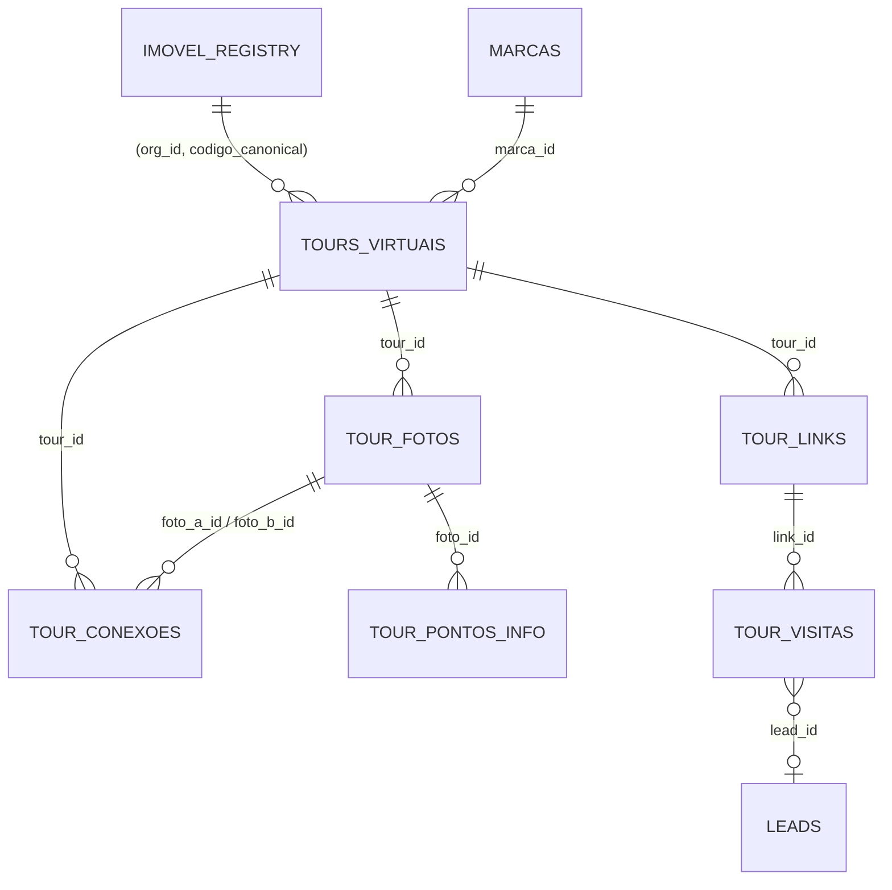

# Data model — Tours Virtuais (v1, proposed)

Schema `social_wiring`. One migration in slice S4, numbered by `noctus.dev.scaffold_migration` at build time (never by hand). Every table: `org_id UUID NOT NULL`, RLS on, `COMMENT ON TABLE … 'tier:org'`, explicit `REVOKE ALL … FROM anon`, service-role ALL policy for backend writes, `updated_at` trigger from `noctusai_lib.domain.sql_templates`. Reads that the browser may do directly use `org_id = public.current_org_id()` (the 040/181 shape — never `auth.jwt()`).

## `tours_virtuais`

| Column | Type | Notes |
|---|---|---|
| `id` | uuid PK | |
| `org_id` | uuid | |
| `codigo_imovel` | text NOT NULL | FK `(org_id, codigo_imovel)` → `imovel_registry (org_id, codigo_canonical)` ON DELETE RESTRICT; canonical form `upper(btrim())` (062) |
| `segmento` | text NOT NULL default `'imobiliario'` | CHECK `IN ('imobiliario','obra')`; the API refuses `obra` in v1 (422 `segmento_indisponivel`) — the column only keeps the model open (D-O1) |
| `titulo` | text NOT NULL | 1..120 chars |
| `status` | text NOT NULL default `'rascunho'` | CHECK `IN ('rascunho','concluido','removido')` |
| `publicado` | boolean NOT NULL default false | orthogonal to status; the viewer requires `publicado AND status <> 'removido'` |
| `publicado_em` | timestamptz | stamped on false→true |
| `navegacao_modo` | text NOT NULL default `'pins'` | CHECK `IN ('pins','setas','circulos')`; the API accepts only `pins` in v1 |
| `foto_inicial_id` | uuid NULL | FK `tour_fotos(id)` ON DELETE SET NULL (deferred); null ⇒ lowest `ordem` |
| `contato_whatsapp` | text NULL | E.164 digits, normalised with the seed phone helper; null ⇒ org default (Q2) |
| `contato_nome` | text NULL | shown on the button tooltip |
| `lead_form_ativo` | boolean NOT NULL default false | |
| `lead_form_campos` | jsonb NOT NULL default `{"nome":true,"telefone":true,"email":false}` | |
| `lead_form_gatilho_pct` | smallint NULL | null ⇒ button only; else 1..100 (Q3) |
| `autorotacao` | jsonb NOT NULL default `{"ativa":true,"velocidade":1.0,"avancar_ao_completar":false}` | |
| `marca_id` | uuid NULL | FK brand kit (Q7) |
| `removido_motivo` | text NULL | CHECK `IN ('vendido','alugado','concluido','outro')`; required when `status='removido'` |
| `removido_texto` | text NULL | required when motivo = `outro` |
| `removido_em`, `removido_por` | timestamptz, uuid | |
| `criado_por` | uuid NOT NULL | |
| `versao` | integer NOT NULL default 1 | optimistic concurrency (D-T2) |
| `created_at`, `updated_at` | timestamptz | |

Indexes: `(org_id, status)`, `(org_id, codigo_imovel)`. Pending Q5: a partial UNIQUE `(org_id, codigo_imovel) WHERE status <> 'removido'` if the owner wants one active tour per imóvel.

## `tour_fotos`

| Column | Type | Notes |
|---|---|---|
| `id`, `org_id`, `tour_id` | uuid | FK tour ON DELETE CASCADE (rows only disappear with a hard purge; soft removal is on the tour) |
| `ordem` | integer NOT NULL | dense 0..n-1, rewritten only by the reorder endpoint |
| `nome` | text NOT NULL default `''` | cômodo label |
| `status` | text NOT NULL | CHECK `IN ('aguardando_envio','processando','pronta','erro')` |
| `erro_codigo` | text NULL | `formato_invalido`, `imagem_grande_demais`, `arquivo_ausente`, `decodificacao_falhou` |
| `fonte` | text NOT NULL | CHECK `IN ('camera_360','celular','fake')` — `celular` only reachable when P3 ships its adapter |
| `path_original`, `path_web`, `path_thumb`, `path_preview` | text | storage PATHS in bucket `tours-virtuais`, never URLs; key layout `{org_id}/{tour_id}/{foto_id}/{variante}.jpg` |
| `largura`, `altura`, `bytes` | integer | of the original |
| `sha256` | text | duplicate warning within a tour |
| `proporcao_ok` | boolean | 2:1 ± 1 %; false = warning chip, not a block |
| `vista_inicial_yaw`, `vista_inicial_pitch` | double precision | radians, D-T5; from GPano XMP when present, else 0/0 |
| `proveniencia` | jsonb | `EquirectImage.provenance` (camera model from EXIF when present, GPano flags, quality fields for P3) — no GPS |
| `versao` | integer NOT NULL default 1 | |
| `created_at`, `updated_at` | | |

Index `(tour_id, ordem)`. Replace = new original on the SAME row (`versao` bump, paths rewritten, re-ingest); connections survive because they reference the id.

## `tour_conexoes` (one row per pair, D-T5)

| Column | Type | Notes |
|---|---|---|
| `id`, `org_id`, `tour_id` | uuid | |
| `foto_a_id`, `foto_b_id` | uuid | FK `tour_fotos` ON DELETE CASCADE; CHECK `foto_a_id < foto_b_id`; UNIQUE `(tour_id, foto_a_id, foto_b_id)` |
| `pin_a_yaw`, `pin_a_pitch` | double precision | where, in photo A, the pin pointing to B sits |
| `pin_b_yaw`, `pin_b_pitch` | double precision | where, in photo B, the pin pointing to A sits |
| `a_para_b_vista_inicial`, `b_para_a_vista_inicial` | boolean default false | arrival uses the target's own start view |
| `versao`, `created_at`, `updated_at` | | |

A trigger refuses a row whose two photos belong to different tours. Deleting a photo deletes its pairs (cascade) — both directions at once, by construction.

## `tour_pontos_info`

`id, org_id, tour_id, foto_id (FK cascade), tipo CHECK IN ('texto','link') [v1; 'imagem','video' in P4], titulo (≤80), conteudo (texto ≤1000 | https URL), yaw, pitch, versao, created_at, updated_at`. Link URLs are `https://` only, validated server-side.

## `tour_links` — no browser grant

`id, org_id, tour_id, token text UNIQUE (128-bit base64url), canal text NULL (P5: 'imovelweb','vivareal',…), rotulo text NULL, criado_por, criado_em, revogado_em`. Partial UNIQUE `(tour_id) WHERE revogado_em IS NULL AND canal IS NULL` = one active public link per tour in v1. `REVOKE ALL FROM authenticated, anon`; read through the API only (a link is a capability).

## `tour_visitas` — no browser grant

`id, org_id, tour_id, link_id, iniciada_em, finalizada_em, dispositivo CHECK IN ('desktop','mobile','tablet','desconhecido'), referrer_host text NULL, canal text NULL, fotos_vistas smallint, duracao_s integer, whatsapp_clicado boolean default false, lead_id uuid NULL (FK leads ON DELETE SET NULL)`. Written only by the viewer API (service role). No IP, no user agent, no cookie id (D-T14). Index `(org_id, tour_id, iniciada_em)`. Retention: proposed 24 months, swept by the existing retention scheduler (`app/services/retention_sweep_scheduler.py`) — owner confirms with Q12.

## Plan cap

No table. `TourQuota.limite(org_id)` reads `public.plans.features->>'tours_virtuais_max'` via the org's active subscription; `usados = count(tours_virtuais WHERE status <> 'removido')`. (D-T13, Q4.)

## RLS summary

| Table | authenticated SELECT | authenticated write | anon | service role |
|---|---|---|---|---|
| `tours_virtuais`, `tour_fotos`, `tour_conexoes`, `tour_pontos_info` | own org | none (API only) | none | ALL |
| `tour_links`, `tour_visitas` | none | none | none | ALL |

Storage: bucket `tours-virtuais`, `public = false` (gated by `check_storage_bucket_public` + the live predeploy leg). No `storage.objects` policy for `anon`; reads happen through signed URLs minted by the API.
