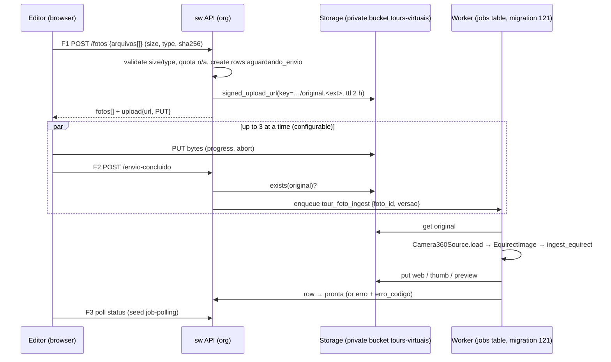

# Ingest pipeline + `PanoramaSource` seam (v1, proposed)

Origin of the seam: `[private study: specs/phone-to-360-implementation-options.md]` §6.2 (one artifact for v1 and the future phone capture). This doc is our design; names are ours.

## 1 · Flow (D-T4: parallel, direct to storage)



- The FE computes `sha256` with `crypto.subtle` before F1 (duplicate warning, not a block).
- A browser tab closed mid-upload leaves rows `aguardando_envio`; a sweep (in the same worker loop) deletes rows older than 24 h with no object, and their keys.
- Cancel = abort the PUT + `DELETE` the photo (F7).
- No step serialises across photos; the worker runs `concurrency` jobs per process (start with 2: Pillow on a 60-MP image peaks around 0.5–1 GB RSS; measured in S1).

## 2 · Seed module `noctusai_lib.integrations.panorama` (S1)

```python
@dataclass(frozen=True)
class EquirectImage:
    data: bytes            # decoded-and-re-encoded JPEG, EXIF stripped
    width: int             # == 2 * height (± 1 %), else proporcao_ok False
    height: int
    initial_yaw: float     # radians, from GPano PoseHeading / InitialViewHeadingDegrees, else 0.0
    initial_pitch: float
    provenance: Provenance # source: 'camera_360'|'celular'|'fake'; camera make/model; gpano: bool; quality: dict|None

class PanoramaSource(Protocol):
    source_kind: str
    async def load(self, ref: PanoramaRef) -> EquirectImage: ...   # PanoramaRef = (bucket, key) of the uploaded original

class FakePanoramaSource: ...       # deterministic synthetic 2:1 gradient with a grid, for tests
class Camera360Source: ...          # Real: StorageBackend.get + ImagingAdapter.read_xmp/decode; refuses non-JPEG/PNG,
                                    # > max pixels, undecodable; ratio off ⇒ flag, not refusal
def make_panorama_source(kind: str, *, storage, imaging, use_fake: bool = False) -> PanoramaSource: ...

@dataclass(frozen=True)
class EquirectVariants:
    web: bytes       # ≤ 4096×2048 JPEG q≈82 (mobile-safe texture size; ~1–1.5 MB)
    thumb: bytes     # 640×360 crop around the start view (equirect crop ±60° yaw, ±34° pitch; rectilinear reprojection is P4)
    preview: bytes   # 256×128 + Gaussian blur, inlined as LQIP while `web` loads

def ingest_equirect(img: EquirectImage, *, imaging: ImagingAdapter, cfg: IngestConfig) -> EquirectVariants: ...
def thumb_for_view(original_or_web: bytes, *, yaw: float, pitch: float, imaging) -> bytes: ...  # used by tour_foto_thumb
```

- `ingest_equirect` is the **only** producer of variants; it is pure over `ImagingAdapter` (no storage, no DB), so the product's job handler does: load → ingest → put × 3 → update row. A future `PhoneStitchSource` (P3) produces an `EquirectImage` and reuses everything after `load` unchanged; the viewer, pins and tours never branch on `fonte`.
- `PhoneStitchSource` is **not** stubbed now (no half-shipped Real; D-T12).
- Pillow: raise `Image.MAX_IMAGE_PIXELS` only inside the adapter, to the configured ceiling (default 16384 × 8192 = 134 MP, Q11); anything larger is refused before decoding the full raster (`decodificacao_falhou` vs `imagem_grande_demais`).
- EXIF/GPS: variants never carry EXIF; the private original keeps its bytes untouched (Q10).
- Replacement with `deslocamento_yaw` (F6): the handler rolls the equirect horizontally by `width × Δyaw / 2π` px before `ingest_equirect`, so existing pins keep pointing at the same doors.

## 3 · Seed extensions needed (each ships Protocol + Fake + Real + factory together)

| Extension | Where | Why |
|---|---|---|
| `ImagingAdapter.crop(bytes, box)`, `.gaussian_blur(bytes, radius)`, `.read_xmp(bytes) -> dict`, `.roll_horizontal(bytes, px)` | `noctusai_lib.integrations.imaging` (types, fake_adapter, real_adapter) | thumb, preview, GPano start view, replacement alignment |
| `StorageBackend.signed_upload_url(bucket, key, expires_in_seconds) -> SignedUpload{url, method, headers, expires_at}` | `noctusai_lib.integrations.storage` (protocol, fake, local, supabase) | direct browser → storage upload past the origin timeout |

## 4 · Product side (social-wiring, S4)

- `app/modules/tours_virtuais/services/ingest_job.py` — handlers `tour_foto_ingest`, `tour_foto_thumb`, registered on the existing jobs worker; `RetryPolicy` 3 attempts; `DeadLetterError` for `formato_invalido` / `imagem_grande_demais` (no retry).
- Idempotent: the job's dedupe key is `(foto_id, versao)`; a stale job (row `versao` moved on) completes as a no-op.
- Bucket `tours-virtuais` created private in the S4 migration (`INSERT INTO storage.buckets (id, name, public) VALUES ('tours-virtuais','tours-virtuais', false)`), size limit = Q11 ceiling, MIME `image/jpeg`, `image/png`.

## 5 · Serving (D-T3)

The manifest (V1) and editor reads mint signed URLs per request from the persisted paths (TTL 1 h for panoramas). Nothing is ever written to a public location; there is no static `tour.json`. Publishing is a DB flag read on every request, so unpublishing takes effect within the 60 s response cache.
