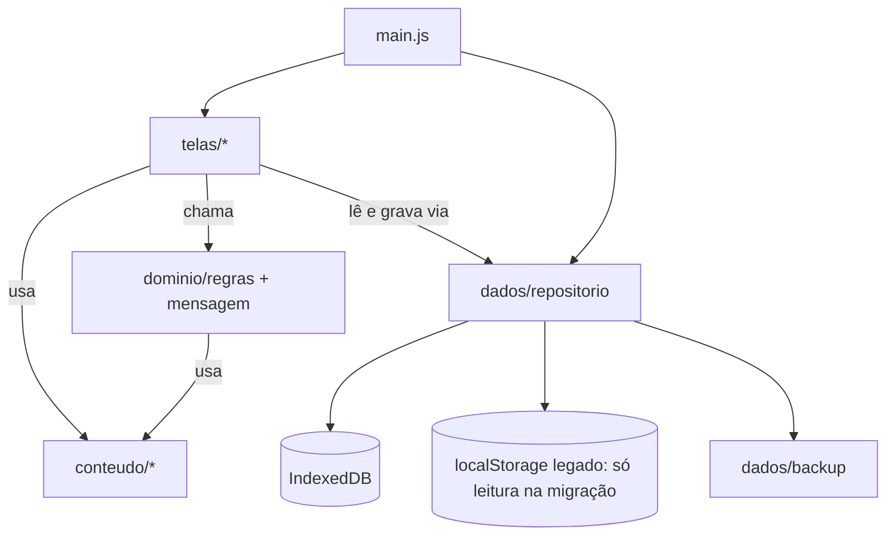

# Integração interna

Como os módulos conversam. Vale para a fase 1 em diante; a fase 0 segue a mesma divisão dentro de um arquivo só.

## Camadas



Regras de dependência:

1. `conteudo/` não importa nada. É só dado.
2. `dominio/` é puro: recebe registros e devolve resultados. Sem acesso a DOM, armazenamento ou relógio direto (recebe `agora` como parâmetro, o que facilita teste).
3. `dados/repositorio.js` é o **único** ponto que toca armazenamento. Telas nunca chamam `indexedDB` ou `localStorage`.
4. `telas/` montam DOM, tratam eventos e chamam repositório e domínio.
5. `main.js` decide abertura ou Semana e liga a navegação.

## Contrato do repositório

```js
// todas as funções retornam Promise
repositorio.iniciar()                       // abre o banco, roda migrações, semeia exemplos se for a primeira vez
repositorio.listarRegistros()               // Registro[] ordenado por criadoEm desc
repositorio.obterRegistro(id)               // Registro | null
repositorio.salvarRegistro(dadosDoFormulario) // Registro (gera id, datas, levar = bring==='sim')
repositorio.marcarLevar(id, booleano)       // Registro
repositorio.apagarRegistro(id)              // void
repositorio.apagarExemplos()                // número apagado
repositorio.lerConfig(chave)                // valor | null
repositorio.gravarConfig(chave, valor)      // void
repositorio.exportar()                      // objeto Backup
repositorio.importar(backup, {modo:'mesclar'}) // {inseridos, atualizados, ignorados}
repositorio.disponivel()                    // false em aba anônima ou bloqueio
```

## Contrato do domínio

```js
regras.isLevar(registro)                       // boolean (RN-08)
regras.janelaSeteDias(agora)                    // {inicio, fim}
regras.filtrar(registros, filtro, busca, agora) // Registro[] (RN-10, RN-11)
regras.contarEmocoes(registros)                 // [[id, n]] ordenado
regras.contarDespertares(registros)             // [[id, n]] ordenado
mensagem.montar(registrosMarcados, {nome, sessao}) // string (formato em 01-produto/04-textos-oficiais.md)
mensagem.linkWhatsApp(texto)                    // string | null (null quando passa de 3500 caracteres codificados)
```

## Estado da interface (em memória, não persistido)

| Estado | Dono | Valor inicial |
|---|---|---|
| aba atual | main | `semana` |
| filtro | semana | `todos` |
| busca | semana | `''` |
| confirmação de apagar exemplos | semana | `false` |
| aviso de registro salvo | semana | `false`, vira `true` ao salvar com Sim, volta a `false` ao sair da Semana |
| passo atual | registrar | `1` |

## Ciclo de atualização

Toda escrita segue: ação da analisanda → repositório grava → tela visível chama seu `render` → toast quando houver. Ao trocar de aba, a tela de destino renderiza a partir do repositório (sem cache entre abas).
