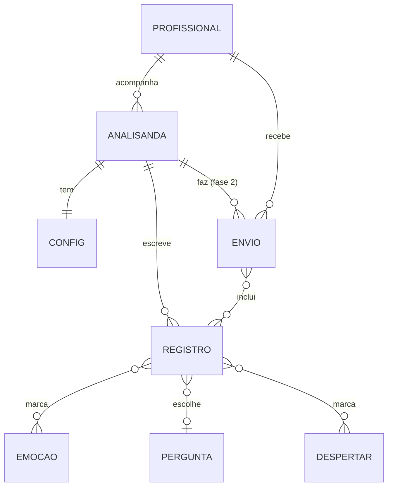

# Modelo de dados

## Entidades

Nas fases 0 e 1 existem só REGISTRO, CONFIG e os catálogos (EMOCAO, PERGUNTA, DESPERTAR, citações), todos no aparelho. ANALISANDA é implícita (o próprio aparelho). ENVIO e PROFISSIONAL só existem na fase 2.

## Registro

| Campo v1 | Campo v2 | Tipo | Obrig. | Passo | Notas |
|---|---|---|---|---|---|
| `id` | `id` | string | sim | | v1: `r` + base36; v2 novos: UUID |
| `example` | `example` | boolean | v2 sim | | Exemplos pré-carregados |
| `ts` | `ts` | inteiro ms UTC | sim | | Momento de salvar |
| | `updatedTs` | inteiro ms UTC | sim | | Alteração de `levar` atualiza |
| `happened` | `happened` | texto ≤ 1500 | sim | 1 | Lead do cartão |
| `mind` | `mind` | texto ≤ 1500 | não | 2 | Lead se `happened` vazio (não ocorre em registros novos) |
| `emotions` | `emotions` | lista de ids | não | 3 | Ordem do catálogo |
| `did` | `did` | texto ≤ 1500 | não | 4 | |
| `q` (0..4) | `questionId` (p1..p5) | | sim | 5 | Ver migração |
| | `questionText` | texto | não | 5 | Cópia do texto na data, recomendado |
| `answer` | `answer` | texto ≤ 2000 | não | 5 | |
| `awakened` (0..5) | `awakenedIds` (d1..d6) | lista | não | 6 | |
| `extra` | `extra` | texto ≤ 1500 | não | 6 | |
| `bring` | `bring` | sim/talvez/nao | sim | 7 | Imutável depois de salvo |
| `levar` (opcional) | `levar` | boolean | v2 sim | Levar | Ausente no v1 = `bring === 'sim'` |

Schemas formais: `schemas/registro.v1.schema.json` e `schemas/registro.v2.schema.json`.

## Configuração

Ver `schemas/config.schema.json`. Chaves: `nome`, `sessao`, `aberturaVista`, `citacaoN`, `exemplosSemeados`, `schemaVersion`, `persistenciaPedida`, `ultimoBackupTs`.

## Catálogos

Fixos no código, textos aprovados. Ver `../01-produto/04-textos-oficiais.md` e `schemas/catalogos.schema.json`. Regra: **nunca reordenar nem apagar item de catálogo**. Item novo recebe id novo; item retirado ganha `ativa: false` e continua legível em registros antigos.

## Dados derivados (não gravados)

- Etiquetas do cartão, contagens do Resumo, texto para Mônica, período da semana. Sempre calculados a partir dos registros.
