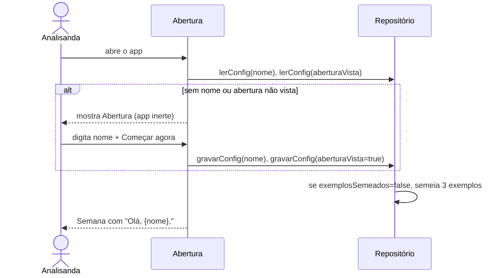
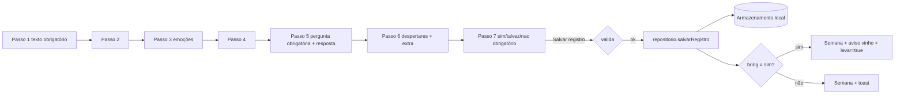
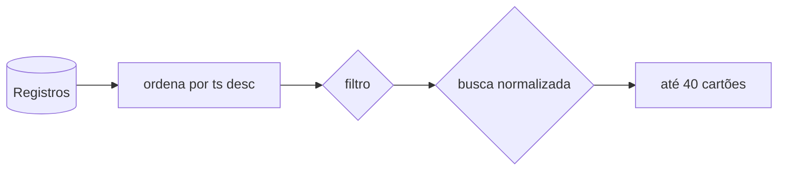
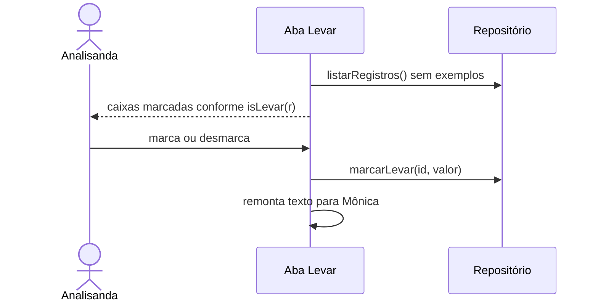
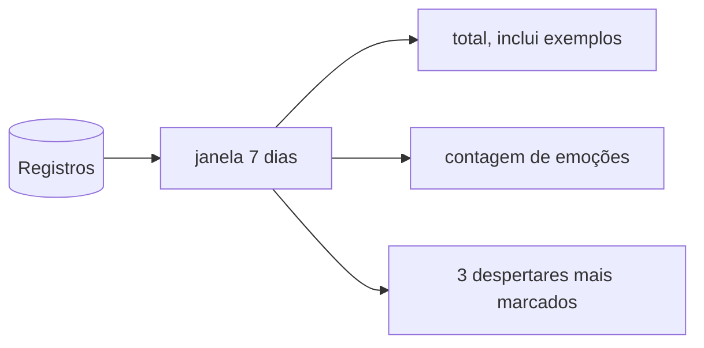
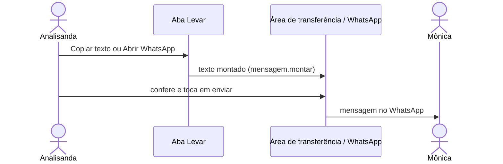
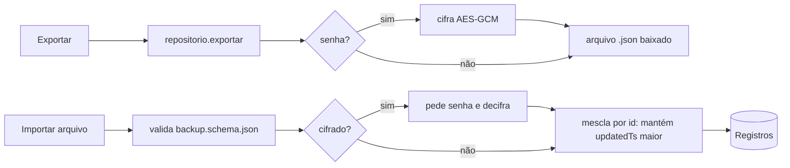

# Fluxos de dados

Diagramas em Mermaid. Cada fluxo indica onde o dado nasce, por onde passa e onde termina. Nas fases 0 e 1, **nenhum fluxo sai do aparelho**, exceto F6, por gesto da analisanda.

## F1. Primeira abertura

## F2. Criar registro

Os dados do formulário ficam só na memória da página até salvar. Sair da aba Registrar no meio do caminho preserva os campos enquanto a página estiver aberta; recarregar perde (backlog: rascunho local).

## F3. Listar, filtrar e buscar

Busca: minúsculas, sem acentos, em `happened`, `mind`, `did`, `answer`, `extra` e rótulos das emoções.

## F4. Marcar o que levar

## F5. Resumo

## F6. Envio a Mônica (único fluxo que sai do aparelho)

O app não sabe se a mensagem foi enviada. Nada é registrado.

## F7. Apagar

- Registro: confirmação em dois toques, exclusão definitiva no aparelho.
- Exemplos: confirmação, remove todos com `example = true`; não voltam (exemplosSemeados continua true).

## F8. Backup (fase 1)

## F9. Migração v1 para v2 (fase 1)

Ver `05-backup-e-migracoes.md`.
